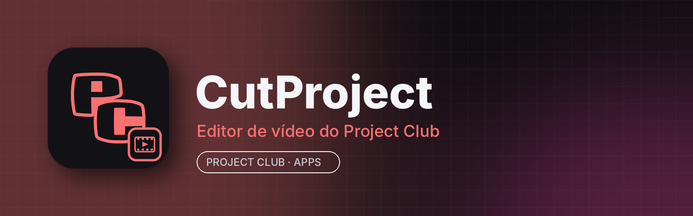

<p align="center"></p>

# CutProject

**CutProject** é o editor de vídeo do **Project Club**: monte vídeos com várias faixas, corte, aplique efeitos, títulos e transições, faça correção de cor e exporte para redes sociais ou em alta qualidade, integrado à aba **Apps** do app para computador.

É baseado no **[Sprocket](https://github.com/SprocketVideo/Sprocket)**, de código aberto sob a licença MIT. Todos os recursos do Sprocket continuam aqui; o CutProject troca o nome e o ícone e faz a integração com o Project Club. (O app se chamava “DaVinci Project”; as configurações, presets e plugins da versão antiga são trazidos sozinhos na primeira abertura.)

## Principais recursos

- Edição não destrutiva em linha do tempo multipista (miniaturas, forma de onda, encaixe e zoom)
- Qualquer formato de sequência, inclusive vertical para redes sociais
- Efeitos na GPU com keyframes: brilho, cor, transformação
- Correção de cor: balanço de branco, rodas de cor, curvas, qualificador HSL e LUTs para footage log
- Títulos, geradores, camadas de ajuste e transições
- Mixer de áudio com envelopes de ganho, pan, mute e solo por faixa
- Mídia proxy (edita em baixa resolução, exporta do original) e cache de render
- Exporta MP4 (H.264/AAC) e outros formatos de vídeo, além de áudio (WAV/FLAC/MP3), com predefinições
- Salvamento automático, recuperação após falha e desfazer/refazer completo
- Controle por assistentes de IA (servidor MCP local, opcional)

## Instalar

Pelo **Project Club** (recomendado): aba **Apps → CutProject → Instalar**. As atualizações chegam por lá.

Manual: baixe em [Releases](../../releases/latest):
- **Windows 10/11 (64 bits):** `cutproject-<versão>-win.zip` → extraia e abra `CutProject.exe`
- **Linux (x86_64):** `cutproject-<versão>-linux.AppImage` → `chmod +x *.AppImage && ./cutproject-*.AppImage`

## Requisitos

| | Mínimo | Recomendado |
|---|---|---|
| Sistema | Windows 10 64 bits / Linux x86_64 (glibc 2.35+, Ubuntu 22.04) | Windows 11 / Ubuntu 24.04 |
| CPU | 4 núcleos | 6–8 núcleos para 4K |
| RAM | 8 GB (o app usa ~0,5–3 GB conforme o projeto) | 16 GB ou mais |
| GPU | Direct3D 11 / OpenGL 3.3 com 2 GB de VRAM | GPU dedicada com 4 GB+ |
| Disco | ~400 MB para o app + mídia, proxies e cache | SSD |

## Compilar

.NET 10 SDK (veja [ARCHITECTURE.md](ARCHITECTURE.md) e [docs/README-Sprocket-original.md](docs/README-Sprocket-original.md)):

```bash
git clone https://github.com/RiqueBitt/CutProject
cd CutProject
dotnet build
dotnet run --project src/Sprocket.App
```

Para gerar os pacotes publicados no Project Club, rode o workflow **Build CutProject release** (Actions → *Run workflow*, informando a versão). Ele compila Windows e Linux (com o FFmpeg incluído) e publica a release `vX.Y.Z` **neste repositório**.

## Créditos e licença

CutProject é uma versão modificada do **Sprocket**, © 2026 D'Arcy Rittich, distribuída sob a **licença MIT** (veja [LICENSE](LICENSE)). Componentes de terceiros (FFmpeg, SkiaSharp, Avalonia, OpenAL Soft e outros) e suas licenças estão em [THIRD-PARTY-NOTICES.md](THIRD-PARTY-NOTICES.md). O CutProject não é afiliado ao Sprocket nem à Blackmagic Design. O README original está em [docs/README-Sprocket-original.md](docs/README-Sprocket-original.md).
